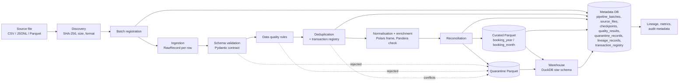
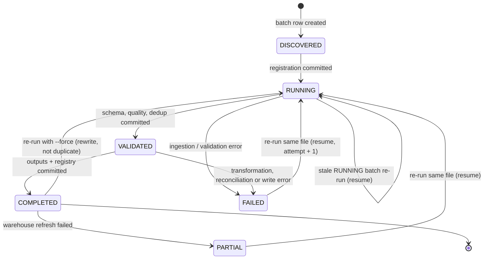

# Architecture

`txn-data-pipeline` is a single-process batch pipeline. One invocation processes one
immutable source file, registers a batch in a metadata database, routes every source row
to exactly one of *accepted*, *rejected* or *duplicate*, and writes curated Parquet,
quarantine Parquet, a reconciliation report and a DuckDB star schema.

The design goal is a small, auditable pipeline whose behaviour can be reasoned about
end to end, not a distributed system. See the last section for what was deliberately
left out.

## Layers

| Layer | Package | Responsibility |
|---|---|---|
| Contract | `txn_pipeline.contracts` | Canonical `TransactionRecord` (Pydantic), controlled vocabularies, the rule catalogue (`rules.py`), the curated frame schema (`schemas.py`, Pandera on Polars), ISO country data |
| Ingestion | `txn_pipeline.ingestion` | File discovery + SHA-256 (`discovery.py`), CSV / JSON Lines / Parquet readers yielding `RawRecord`, canonical row hashing |
| Validation | `txn_pipeline.validation` | Schema stage (`schema.py`), data-quality rules (`quality.py`), duplicate and conflict detection (`duplicates.py`), shared value objects (`results.py`) |
| Transformation | `txn_pipeline.transformation` | Normalisation helpers, money (`currency.py`), timestamps, enrichment expressions (`enrich.py`), curated frame builder (`frame.py`) |
| Reconciliation | `txn_pipeline.reconciliation` | Row-count and per-currency amount controls, report persistence and rendering |
| Warehouse | `txn_pipeline.warehouse` | Idempotent Parquet writers (`writer.py`), DuckDB star-schema builder and bundled queries (`model.py`, `sql/`) |
| Metadata | `txn_pipeline.metadata` | SQLAlchemy models, repository, engine / Alembic helpers, checkpoint definitions |
| Observability | `txn_pipeline.observability` | structlog configuration and event names, in-process metrics, lineage entries |
| Pipeline | `txn_pipeline.pipeline` | `BatchContext`, stage functions (`stages.py`), the orchestrator (status machine, checkpoints, failure handling), result objects |
| CLI | `txn_pipeline.cli.main` | Typer application (`txn-pipeline ...`) |
| Synthetic / adapters | `txn_pipeline.synthetic`, `txn_pipeline.adapters` | Reproducible generator; adapters that map foreign export shapes onto the contract |

Dependencies point downwards: `pipeline` depends on everything below it, `contracts`
depends only on `transformation` helpers (money, timestamps, normalisation).
Record-level problems are never exceptions; they become `Rejection` objects. Exceptions
(`txn_pipeline.exceptions`) are reserved for systemic failures.

## Pipeline flow

Normalisation happens inside the contract validators (trim, upper-case, Decimal parsing,
UTC conversion), so by the time a record reaches the quality stage it is already
canonical. Enrichment is vectorised over the Polars frame and cannot fail per row.

## Stage sequence

The orchestrator runs the stages below in order. Names are the `Stage` enum values and
are also the checkpoint names stored in `pipeline_checkpoints`.

| # | Stage | Function (`pipeline/stages.py`) | Produces |
|---|---|---|---|
| 0 | `DISCOVERY` | `ingestion.discovery.discover_file` | `SourceFile` (path, SHA-256, size, format) |
| 1 | `REGISTRATION` | `PipelineOrchestrator._register` | batch row, or idempotent skip / resume |
| 2 | `INGESTION` | `ingest` | `ctx.raw_records` (adapter applied if any) |
| 3 | `SCHEMA_VALIDATION` | `schema_validation` | `ctx.schema_valid`, rejections |
| 4 | `QUALITY_VALIDATION` | `quality_validation` | `ctx.quality_accepted`, rejections, warnings |
| 5 | `DEDUPLICATION` | `deduplication` | `ctx.dedup` (accepted, duplicates, conflicts, payload hashes) |
| 6 | `TRANSFORMATION` | `transformation` | `ctx.curated` (enriched, Pandera-validated frame) |
| 7 | `RECONCILIATION` | `reconciliation` | `ctx.reconciliation`; raises if unbalanced |
| 8 | `QUARANTINE_WRITE` | `quarantine_write` | quarantine Parquet + `quarantine_records` rows |
| 9 | `CURATED_WRITE` | `curated_write` | partitioned Parquet + post-write row-count check |
| 10 | `REGISTRY_COMMIT` | `registry_commit` | `transaction_registry` upsert, report file, lineage rows |
| 11 | `WAREHOUSE` | `warehouse_build` | DuckDB rebuild (optional, `--no-warehouse` skips it) |
| 12 | `COMPLETION` | orchestrator | final status, metrics |

Every stage is wrapped by `_run_stage`, which writes a `STARTED` checkpoint, runs the
optional `before_stage` hook, the stage, the optional `after_stage` hook, and then a
`COMPLETED` checkpoint with stage-specific details (counts, paths). On exception the
checkpoint becomes `FAILED` and the exception propagates to the orchestrator. The hooks
exist for failure-injection tests only.

## BatchContext

`BatchContext` is a mutable dataclass that travels through the stages. It carries the
settings, the repository, the metrics collector, the `SourceFile`, the batch ORM row and
the intermediate results (`raw_records`, `schema_valid`, `quality_accepted`,
`rejections`, `rule_counts`, `dedup`, `curated`, `reconciliation`, output paths,
`warehouse_counts`, `notes`). Derived views such as `accepted`, `all_rejections`
(schema + quality rejections plus dedup conflicts, ordered by record number) and
`warning_count` are properties so every stage and the result builder see the same
definition.

## Transaction boundaries in the metadata database

The repository uses explicit commits so that the metadata always describes a
consistent state:

1. after registration: `source_files` row, batch row in status `RUNNING`;
2. after `DEDUPLICATION`: batch counts and per-rule `quality_results`, status `VALIDATED`;
3. after `REGISTRY_COMMIT`: quarantine rows, registry upsert, lineage rows, reconciliation
   report on the batch; immediately afterwards the batch is set to `COMPLETED` and
   committed, because all data outputs now exist;
4. the warehouse refresh runs last; if it fails the batch is downgraded to `PARTIAL`
   (curated data is trustworthy, analytics are stale) and the error is recorded;
5. metrics and the `COMPLETION` checkpoint are written in a final commit.

Any exception before step 3 rolls back the open session, re-fetches the batch, stores
the error message and sets `FAILED`. Curated files are only ever written after
reconciliation has balanced in memory, so a `FAILED` batch has no curated partitions
from the failing attempt (a retry also deletes any partition of the same batch id before
writing).

## Batch status machine

Restartable statuses are `DISCOVERED`, `RUNNING`, `FAILED` and `PARTIAL`
(`RESTARTABLE_STATUSES` in `contracts/enums.py`). A `COMPLETED` batch for the same
source hash makes a re-run a no-op unless `--force` is given. See
[OPERATIONS.md](OPERATIONS.md) for the operator view and
[ADR 0005](ADR/0005-file-hash-idempotency.md) for the idempotency rules.

## Two contract boundaries

1. **Record contract** (`TransactionRecord`): each raw row either becomes an immutable,
   normalised record or a `Rejection` with a stable rule id.
2. **Frame contract** (`CURATED_SCHEMA`, Pandera on Polars): the whole curated frame is
   validated for column set, dtypes, nullability and value domains before it is written.
   A violation here is a systemic `StageError`, not a per-row rejection, because it means
   the transformation code is wrong.

See [DATA_CONTRACT.md](DATA_CONTRACT.md).

## Why not Spark, Kafka, Airflow or dbt

The target volume is tens of thousands to a few hundred thousand rows per file. A
single Python process with Pydantic, Polars and DuckDB handles that in seconds with
exact decimal arithmetic. Spark would add a cluster abstraction with no benefit at this
size; Kafka solves streaming problems this batch pipeline does not have; Airflow would
schedule a single command and hide the state machine that this project wants to make
explicit; dbt would wrap six `CREATE TABLE AS` statements in a second tool and
templating language. Each of these could sit around the pipeline later (an Airflow task
calling `txn-pipeline run`, dbt models over the curated Parquet) without changing the
core.
