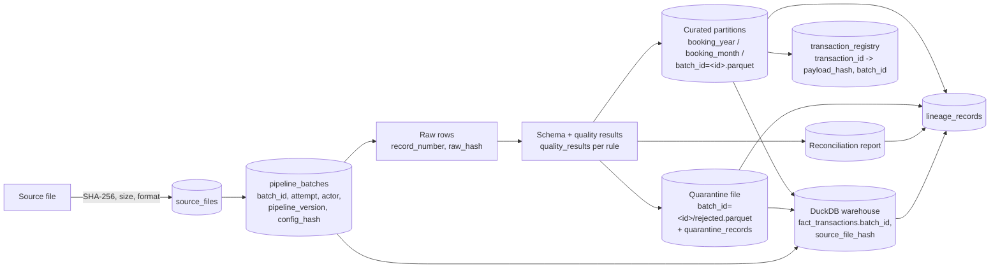

# Lineage

Lineage answers two questions for any curated row or warehouse fact: *which source line
produced it, under which code and configuration*, and *which outputs did a given source
file produce*. It is captured at batch level in the metadata database and at row level
in the curated Parquet files.



## Batch-level lineage: `lineage_records`

One row per output artefact of a batch, written in `REGISTRY_COMMIT` and `WAREHOUSE`:

| Column | Meaning |
|---|---|
| `batch_id` | the producing batch |
| `source_filename`, `source_hash` | the input file identity (SHA-256) |
| `output_kind` | `CURATED_PARTITION`, `QUARANTINE_FILE`, `RECONCILIATION_REPORT` or `WAREHOUSE` |
| `output_path` | absolute path of the partition, quarantine file, report or DuckDB file |
| `row_count` | rows in that artefact (fact rows for the warehouse) |
| `pipeline_version` | package version that produced it |
| `created_at` | UTC timestamp |

`(batch_id, output_kind, output_path)` is unique; a retried batch updates the row count
of an existing entry instead of adding a second one. `txn-pipeline batch-status
--batch-id <id>` lists these rows.

## Row-level lineage in curated Parquet

Every curated row carries:

| Column | Meaning |
|---|---|
| `batch_id` | batch that curated the row |
| `source_filename` | file name as discovered (informational; the hash is the identity) |
| `source_file_hash` | SHA-256 of the source file |
| `source_record_number` | 1-based line / row number in the source file |
| `raw_record_hash` | SHA-256 of the canonical JSON of the raw row |
| `payload_hash` | SHA-256 of the normalised business payload (same value as in `transaction_registry`) |
| `ingested_at` | UTC timestamp of the batch attempt |
| `pipeline_version` | package version |
| `transaction_timestamp_raw` | the timestamp text exactly as received, offset included |

Quarantine rows carry the equivalent set (`batch_id`, `record_number`,
`source_filename`, `source_file_hash`, `raw_record`, `quarantined_at`,
`pipeline_version`).

## Tracing

**Backwards, curated row to source line.** Take `source_file_hash` and
`source_record_number` from the row. `source_files` gives the original path and name for
that hash; the record number is the row's position in that file (1-based, header
excluded for CSV). `raw_record_hash` lets you confirm the line is unchanged.

**Forwards, source file to outputs.** Hash the file (`sha256sum`), look up
`pipeline_batches.source_hash`, then `lineage_records` for that batch. Every curated
partition, the quarantine file, the report and the warehouse refresh are listed with
row counts.

**Into the warehouse.** `fact_transactions` keeps `transaction_id`, `batch_id`,
`source_file_hash` and `pipeline_version` as degenerate columns, so a fact row joins
back to its curated row (`transaction_id`) and to the batch that produced it.

```sql
-- DuckDB: facts produced by one source file
SELECT batch_id, COUNT(*) AS facts, SUM(amount_minor) AS minor_units
FROM fact_transactions
WHERE source_file_hash = '<sha256>'
GROUP BY batch_id;
```

## Audit metadata on `pipeline_batches`

| Column | Meaning |
|---|---|
| `actor` | who started the batch: `CLI`, `SYSTEM` or `TEST` (`Settings.actor`). There is no user authentication; this records the invoking context only |
| `pipeline_version` | package version from `importlib.metadata` |
| `config_hash` | SHA-256 of the behavioural settings (`SOURCE_TIMEZONE`, `MIN_BOOKING_DATE`, `MAX_BOOKING_DAYS_IN_FUTURE`, `VALUE_DATE_TOLERANCE_DAYS`, `TIMESTAMP_BOOKING_TOLERANCE_DAYS`, `FAIL_ON_WARNINGS`). Connection strings and paths are excluded so credentials never enter audit data |
| `schema_version` | contract version the batch was validated against |
| `correlation_id` | per-attempt id that also appears on every log line of the run |
| `attempt` | incremented on each resume |
| `started_at`, `completed_at` | UTC timestamps; `completed_at` is set for `COMPLETED`, `FAILED` and `PARTIAL` |
| `metrics` | the metrics summary of the last attempt (JSON) |
| `error_message` | last error for `FAILED` / `PARTIAL` |

Checkpoints in `pipeline_checkpoints` add a per-stage timeline (`stage`, `status`,
`attempt`, `started_at`, `completed_at`, `details`).
