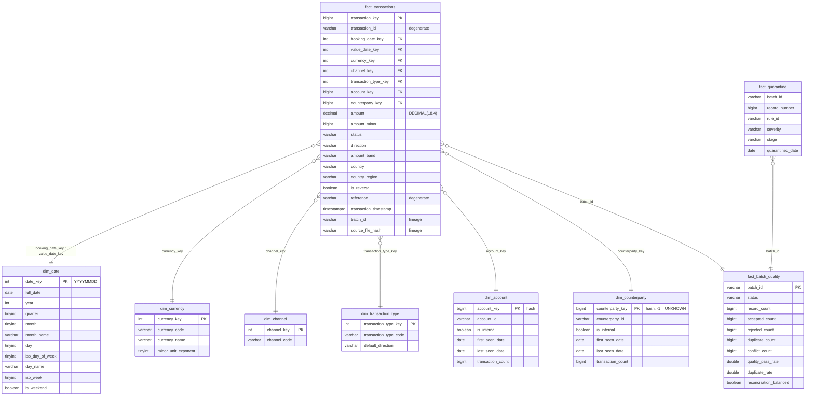

# Warehouse model

The analytical layer is a DuckDB star schema rebuilt from the curated Parquet files and
the batch metadata. Builder: `warehouse/model.py`; DDL:
`src/txn_pipeline/warehouse/sql/schema/*.sql`; bundled queries:
`src/txn_pipeline/warehouse/sql/queries/*.sql`. Default file:
`<DATA_ROOT>/warehouse/txn_warehouse.duckdb` (`WAREHOUSE_PATH` overrides it).



## Grain

`fact_transactions`: **one accepted canonical financial transaction**. `transaction_id`
is unique across the table because the curated layer is deduplicated within batches and
across batches through the transaction registry. Reversals are separate facts
(`is_reversal`, `original_transaction_id`); nothing is netted.

Measures: `amount` (DECIMAL(18,4), summed exactly by DuckDB) and `amount_minor`
(integer minor units). Always group by currency before summing. Degenerate dimensions
kept on the fact: `transaction_id`, `reference`. Lineage columns kept on the fact:
`batch_id`, `source_file_hash`, `pipeline_version`.

## Dimensions

| Table | Source | Key | Notes |
|---|---|---|---|
| `dim_date` | generated from the min to max of `booking_date` / `value_date` in the curated data | smart key `YYYYMMDD` | ISO weekday (1 = Monday), ISO week, `is_weekend` |
| `dim_currency` | contract vocabulary `Currency` with ISO name and minor-unit exponent | ordinal by code | complete even if a currency has no facts |
| `dim_channel` | contract vocabulary `Channel` | ordinal by code | |
| `dim_transaction_type` | contract vocabulary `TransactionType` | ordinal by code | `default_direction` mirrors the enrichment rule |
| `dim_account` | distinct `account_id` in curated data | `hash(account_id) >> 1` | `is_internal` = starts with `ACC-`; first / last seen dates, counts |
| `dim_counterparty` | distinct non-null `counterparty_id` plus a sentinel row | `hash(counterparty_id) >> 1`, `-1` for `UNKNOWN` | null counterparties on the fact map to `-1` |

Operational tables: `fact_batch_quality` (one row per batch, loaded from
`pipeline_batches` through the repository) and `fact_quarantine` (one row per
quarantined record, read from the quarantine Parquet files).

## Surrogate keys

See [ADR 0007](ADR/0007-deterministic-surrogate-keys.md).

* **Date**: the conventional smart key `YYYYMMDD` integer, computed on the fact side
  without a lookup.
* **Static vocabularies** (`dim_currency`, `dim_channel`, `dim_transaction_type`):
  `row_number()` over the sorted code. Codes come from the contract enums, so the keys
  are stable as long as codes are only appended.
* **Accounts, counterparties, transactions**: `CAST(hash(x) >> 1 AS BIGINT)`, DuckDB's
  64-bit hash shifted right by one so it fits a signed `BIGINT` and is never negative.
  The key is a pure function of the natural key, so facts and dimensions can be built
  independently and a rebuild yields identical keys. A natural-key collision is
  theoretically possible but not a practical concern at this scale.
* **Unknown counterparty**: sentinel key `-1`, `counterparty_id = 'UNKNOWN'`.

No slowly changing dimensions are modelled; the dimensions describe the current curated
data.

## Full rebuild

`txn-pipeline warehouse-build` (and the `WAREHOUSE` stage of a run) replaces every
table with `CREATE OR REPLACE TABLE ... AS SELECT` over a staging view that reads all
curated partitions. There is no incremental load: the curated Parquet is the system of
record and the warehouse is a derived view of it, which is why rebuilding is idempotent
and why a failed rebuild leaves the batch `PARTIAL` rather than `FAILED`. For the
target volume (up to a few hundred thousand rows) a rebuild takes well under a second.

## Curated Parquet layout

```
<DATA_ROOT>/curated/booking_year=2026/booking_month=10/batch_id=<uuid>.parquet
```

The partition columns are also stored inside each file, so the staging view reads with
`hive_partitioning = false` and `union_by_name = true`; the directory layout is for
humans, other tools and pruning, not for DuckDB's column inference. One file per batch
per month keeps files few at this scale and makes "delete this batch's output" a glob.

## Bundled queries

Run with `txn-pipeline query <name>` (`txn-pipeline query` lists them).

| Name | What it shows |
|---|---|
| `daily_volume` | accepted transactions per booking date with day name |
| `daily_value_by_currency` | count and exact amount total per booking date and currency |
| `top_transaction_types` | transaction types ranked by count with share of total |
| `channel_distribution` | channel counts and shares |
| `weekend_activity` | weekend versus weekday counts and totals by currency |
| `rejected_trend` | quarantined records per rule, severity and stage over time |
| `duplicate_rate` | duplicate and conflict counts and duplicate rate per batch |
| `batch_quality_trend` | pass rate, rejections and reconciliation outcome per batch |

## Opening the warehouse directly

```bash
duckdb data/warehouse/txn_warehouse.duckdb \
  "SELECT c.currency_code, COUNT(*) AS n, SUM(f.amount) AS total
   FROM fact_transactions f JOIN dim_currency c USING (currency_key)
   GROUP BY 1 ORDER BY 2 DESC"
```

```python
import duckdb

con = duckdb.connect("data/warehouse/txn_warehouse.duckdb", read_only=True)
print(con.sql("SELECT amount_band, COUNT(*) FROM fact_transactions GROUP BY 1"))
```

Open it read-only while the pipeline is not writing; DuckDB files take a single writer.

## Why not dbt

The warehouse is six dimension tables, three fact tables and one staging view, all
expressed as plain SQL files that the Python builder executes in order. dbt would add a
second project layout, Jinja templating and a profiles file for the same statements,
and its test layer would duplicate the Pandera and reconciliation controls that already
guard the curated data. If the model grew (incremental facts, snapshots, many marts),
dbt-duckdb over the curated Parquet would be the natural next step.
